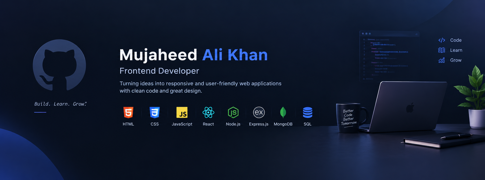

# Hi, I'm Mujaheed Ali Khan 👋

### Aspiring Frontend Developer | React.js | JavaScript

I'm a Computer Applications graduate passionate about building responsive and user-friendly web applications.

- 🌱 Currently improving my frontend development skills
- 💻 Building projects with HTML, CSS, JavaScript and React.js
- 🚀 Exploring full-stack web development

### 🛠️ Technologies

HTML | CSS | JavaScript | React.js | Node.js | MongoDB | Express.js | SQL

### 🤖 AI Tools

- ChatGPT — Learning, brainstorming, debugging, and code explanations
- Google Gemini — Research, problem-solving, and development assistance
- GitHub Copilot — AI-assisted code completion and coding suggestions

### 🌐 Connect With Me

- Portfolio: https://personal-portfolio-coral-rho.vercel.app
- LinkedIn: https://linkedin.com/in/mujaheedalikhan
- GitHub: https://github.com/MujaheedAliKhan
